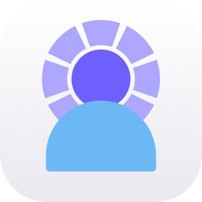
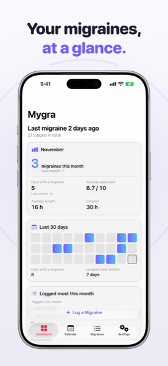
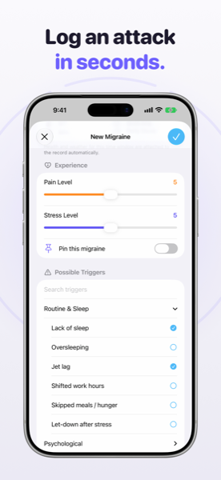
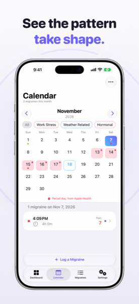
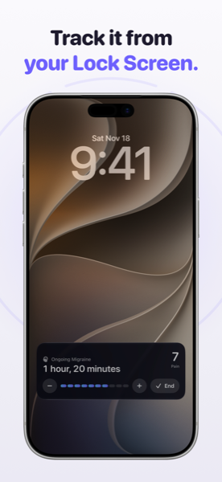

<p align="center">
  
</p>

<h1 align="center">Mygra</h1>

<p align="center"><strong>A calm, private migraine journal. Log an attack in seconds and keep a clear record.</strong></p>

<p align="center">
  <a href="https://apps.apple.com/us/app/mygra/id6747298583">App Store</a> &middot;
  <a href="https://farsidesoftware.com/mygra">Product page</a> &middot;
  <a href="https://farsidesoftware.com/support">Support</a> &middot;
  <a href="https://farsidesoftware.com/privacy">Privacy policy</a>
</p>

<p align="center">
  
  
  
  
</p>

Mygra logs each migraine with its intensity over time, attaches the Apple Health and weather context around it, and shows your history back to you. It runs on iPhone and Apple Watch and syncs privately through your own iCloud. Mygra is a journal, not a medical device, and gives no medical advice. This repository is the current codebase, which is Mygra 3.0.

## What it does

- **Migraine journal.** Start an ongoing migraine, with a Live Activity and Dynamic Island timer, or log a finished one. Pin, filter, and search your history.
- **Intensity tracking.** Record pain and stress as an attack evolves and see the curve on each migraine.
- **Health and weather context.** Sleep, hydration, caffeine, energy, steps, and heart rate from Apple Health, plus conditions and pressure from WeatherKit, attached when you log.
- **Dashboard.** This month against last, a 30-day strip, your most-logged triggers and medications, and when attacks tend to start.
- **Calendar, tags, and reports.** A calendar colored by severity, your own tags, and PDF and CSV export.
- **Migraine Assistant.** On-device Apple Intelligence explanations and chat over your own entries.
- **Siri, Shortcuts, and widgets.** Ask when your last migraine was, log a medication or trigger by voice, and use the days-since widget and Live Activity.
- **Apple Watch.** See days since your last migraine, start one, or end it from your wrist.
- **iPhone Duo.** Two-column detail pages, calendar and list side by side, and a Settings split view when unfolded.

Logging, history, the calendar, Apple Health, Apple Watch, Siri, and the dashboard are free. Mygra Plus adds the Migraine Assistant, Quick Bits, weather alerts, Cycle Insights, and PDF and CSV reports.

## Platforms and requirements

- iPhone and iPad (iOS 18 or later), Apple Watch (watchOS 10 or later), and Apple Vision Pro. Apple Intelligence features need a supported device and OS.
- To build: Xcode 27, Swift 6 language mode. HealthKit, WeatherKit, and Apple Intelligence need a real device.

## Building

Open `Mygra.xcworkspace`. It resolves the local package in `Packages/Mygra`, and there are no external dependencies.

```sh
xcodebuild -workspace Mygra.xcworkspace -scheme Mygra \
  -destination 'platform=iOS Simulator,name=iPhone 17 Pro' build
```

Run the package tests, which need no simulator:

```sh
cd Packages/Mygra && swift test
```

## Project layout

```
Mygra/
├── Mygra/                  App target: @main, App Intents, Spotlight, background tasks, menu commands
├── MygraWidgets/           Days-since widget and ongoing-migraine Live Activity
├── Mygra Wrist Watch App/  Watch companion
├── Mygra Wrist Widgets/    Watch complication
├── Packages/Mygra/         The app itself: an SPM umbrella package of layered modules
├── AppStore/               App Store copy for each release
├── Icons/                  App icon source
└── Scripts/                Localization tooling
```

`CLAUDE.md` has the module-by-module tour.

## Privacy

Your migraine data stays on your device and in your private iCloud. Health data is read and written only with your permission, and insights and the assistant run on-device. No accounts, no analytics, no tracking.

---

Made by [Farside Software LLC](https://farsidesoftware.com). Released under the MIT License, see [LICENSE](LICENSE).
